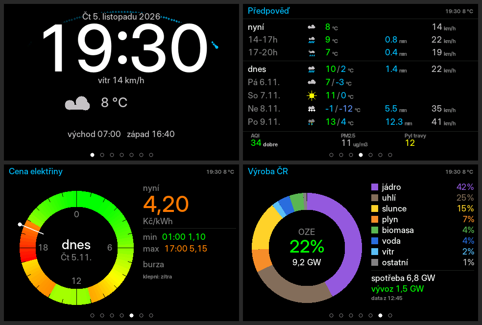

# ESPD35 MeteoPlaneRadar

Hodiny, radar letadel, srážkový meteoradar a předpověď počasí na desce
**LaskaKit ESPD‑3.5"**. Bez pájení — stačí deska, USB‑C kabel a WiFi.

> Vychází z [petus/MeteoPlaneRadar](https://github.com/petus/MeteoPlaneRadar)
> (autor Petr, původně pro chiptron.cz). Portováno a rozšířeno pro
> [laskakit.cz](https://www.laskakit.cz).

Aktuální verze: **0.5.0** — změny viz [CHANGELOG.md](CHANGELOG.md).



---

## Co to umí

Sedm obrazovek. Přepínají se dlouhým stiskem nebo klepnutím na tečky dole.
Šest z nich se dá vypnout; obě energetické jsou ve výchozím stavu vypnuté.

| Obrazovka | Co ukazuje |
| --- | --- |
| 🕐 **Hodiny** | Čas, datum, aktuální počasí, vítr, východ a západ slunce. Sekundy běží po elipse kolem displeje. |
| ✈️ **Letadla** | Radar z [adsb.fi](https://adsb.fi) — ikona podle typu letadla natočená podle kurzu, barva podle výšky (barvy i hranice jdou změnit). Volitelně se obrazovka ukáže sama, jen když letí letadlo poblíž nebo ve výhledu z okna. V panelu detail nejbližšího letadla včetně trasy letu. Rozsahy 10 / 25 / 50 / 100 km. |
| 🌧️ **Meteoradar** | Srážky z [ČHMÚ](https://opendata.chmi.cz), animace 6 snímků za posledních 25 minut, zdroj ČHMÚ nebo ČHMÚ masked. Volitelně jen při bouřce v okolí. Rozsahy 25 / 50 / 100 / 200 km a celá ČR. |
| 🌤️ **Předpověď** | Nyní a dvě tříhodinová okna (např. 14‑17h), dnešek a další čtyři dny s datem, ovzduší (AQI, PM2.5, pyl). Z [Open‑Meteo](https://open-meteo.com). |
| ⚡ **Cena elektřiny** | Spotová cena z denního trhu OTE po čtvrthodinách ([spotovaelektrina.cz](https://spotovaelektrina.cz)). Den jako prstenec od zelené po červenou, cena právě teď, nejlevnější a nejdražší blok. Klepnutím dnes / zítra. Jen pro ČR. |
| 🏭 **Výroba elektřiny** | Z čeho se právě vyrábí, podíl OZE, spotřeba a vývoz/dovoz. ENTSO‑E přes [energy‑charts.info](https://energy-charts.info), země volitelná. |
| ⚙️ **Nastavení** | Jas, orientace mapy, jednotky, adresa webu, tovární reset. |

Všechno ostatní se nastavuje **v prohlížeči** — poloha, obrazovky, filtry
letadel, WiFi i aktualizace firmwaru.

Polohu není třeba zadávat, zjistí se podle IP adresy.

Text se kreslí vyhlazeným písmem s diakritikou (Inter, Poppins, Inter tenké;
lze vrátit původní pixelové). Deska si pamatuje až tři WiFi sítě.

Jazyk displeje i webového nastavení je **čeština** nebo **slovenčina**
(Poloha a displej → Jazyk).

### Home Assistant

Po zapnutí na záložce **Home Assistant** vrací
`http://espd35meteoradar.local/api/ha` JSON (počasí, cena elektřiny, letadla,
bouřka, …) pro integraci RESTful. Hotový blok do `configuration.yaml` se
dá na té záložce zkopírovat. Ve výchozím stavu vypnuto.

---

## Hardware

| | |
| --- | --- |
| Deska | [LaskaKit ESPD‑3.5" ESP32‑S3 TFT ILI9488 CAP Touch Rev. 3.2](https://www.laskakit.cz/laskakit-espd-35-esp32-3-5-tft-ili9488-touch/?variantId=12161) |
| Displej | 3.5" TFT ILI9488, 480×320, SPI |
| Dotyk | kapacitní FT5436 (I2C) |
| Krabička | [Krabička pro ESPD‑3.5"](https://www.laskakit.cz/laskakit--krabicka-pro-espd-35/?variantId=12574) |

Deska nemá žádné tlačítko — ovládá se celá dotykem.

---

# Pro uživatele: nahrání bez programování

Nepotřebuješ Arduino IDE ani nic instalovat. Stačí prohlížeč.

**Potřebuješ:** Chrome nebo Edge (Firefox a Safari to neumí) a USB‑C kabel,
který vede i data — ne jen nabíjecí.

1. Otevři **webový flasher** (odkaz na stránce projektu).
2. Připoj desku do počítače kabelem ke konektoru označenému **„USB"**.
3. Klikni na **Connect** a v seznamu vyber port desky.
4. Klikni na **Install** a počkej. Deska se sama restartuje.

### První spuštění

1. Deska vytvoří otevřenou WiFi síť **`ESPD35-MeteoPlaneRadar`**.
2. Na displeji se ukáže **QR kód** — naskenuj ho telefonem a připoj se.
3. V prohlížeči otevři **`http://192.168.4.1/`**, vyber svou WiFi a zadej heslo.

Deska čeká, dokud síť nezadáš — žádný časový limit. Telefon nahlásí, že síť
nemá internet; to nevadí.

Potom najdeš nastavení na **`http://espd35meteoradar.local/`** (adresa je
i na obrazovce Nastavení).

### Ovládání dotykem

| Gesto | Co udělá |
| --- | --- |
| Dlouhý stisk vlevo / vpravo | předchozí / následující obrazovka |
| Klepnutí na tečky dole | skok na danou obrazovku |
| Přejetí prstem vlevo / vpravo | změna rozsahu |
| Klepnutí na letadlo | zafixuje ho v detailu |
| Klepnutí do prázdné mapy | zpět na nejbližší letadlo |
| Klepnutí na prstenec ceny | vypíše vybranou čtvrthodinu |
| Klepnutí doprostřed ceny / swipe | dnes ↔ zítra |

### Nastavení v prohlížeči

Osm záložek:

- **Stav** — čas, adresa, signál, doba běhu, volná paměť, stav zdrojů dat.
  Odsud jde přepnout obrazovku i rozsah na dálku.
- **Poloha a displej** — poloha (ručně nebo vyhledáním města), jazyk
  (čeština / slovenčina), jas ve dne a v noci, automatické přepínání podle
  slunce, písmo.
- **Obrazovky** — které se zobrazují, automatické střídání, styl sekund;
  meteoradar: zdroj (ČHMÚ / ČHMÚ masked), legenda a „jen při bouřce“.
- **Letadla** — jednotky, směr okna (= co je nahoře na radaru), výšky,
  filtry, hlídaný znak, výhled z okna, letadlo poblíž, barvy výšek, ikony.
- **Energie** — přirážka k burzovní ceně a DPH, země pro výrobu elektřiny.
- **Home Assistant** — data pro integraci RESTful (viz níže).
- **WiFi** — vyhledání sítí, připojení, tři uložené sítě.
- **Správa** — aktualizace firmwaru, záloha, restart, tovární reset, změna
  hesla správce.

Změny platí **po klepnutí na Uložit nastavení**; restart není potřeba.
Záložky Stav, WiFi a Správa mají vlastní tlačítka a Uložit na nich není.
Nastavení vypnuté funkce (bouřka, výhled z okna, letadlo poblíž, Home
Assistant) se ukážou až po jejím zapnutí. Nápovědy mají jednu větu, zbytek
je pod „Více“.

**Heslo správce** se zadává jen pro akci (obnova ze zálohy, restart, reset,
změna hesla); nové heslo má vlastní pole a tlačítko a jde nastavit jen se
současným heslem. Aktualizace firmwaru se na heslo zeptá sama (uživatel
`admin`).

### Orientace mapy

V Nastavení (nebo na webu jako „Okno míří na“) se volí, **který světový směr
je nahoře** na radaru letadel — tedy směr, kterým se díváš z okna. Nastavíš `V`
a letadla na displeji jsou ve stejném směru jako ta za sklem. Stejný směr
používá i výhled z okna. Meteoradar se záměrně neotáčí, srážky se čtou severem
nahoru.

### Aktualizace firmwaru

Ve **Správě** vyber soubor `ESPD35_MeteoPlaneRadar.ino.bin` (ten **bez**
„merged") a klikni na Nahrát. Průběh je vidět v prohlížeči i na displeji.
Když se to nepovede, zůstane v desce původní verze.

### Když se něco pokazí

| Problém | Řešení |
| --- | --- |
| Displej je černý | Nahrávalo se se špatným nastavením PSRAM. Nahraj znovu přes webový flasher. |
| Prázdný meteoradar | Když neprší, kompozit je skoro černý. To je normální. |
| Prázdný radar letadel | Zkus větší rozsah. V noci nebo mimo koridory nemusí být nic. |
| Deska se nepřipojí k WiFi | Nově zadanou síť, ke které se nepřipojí, sama zapomene a vrátí se k QR kódu. Zkus zadat heslo znovu. |
| Po výpadku visí QR kód, i když je síť uložená | Do 30 minut se deska sama restartuje a zkusí uložené sítě znovu (jen když se mezitím nikdo nepřipojí k jejímu přístupovému bodu). |
| Nejde `espd35meteoradar.local` | Použij IP adresu z obrazovky Nastavení. |
| Zapomenuté heslo správce | Tovární reset na obrazovce Nastavení (dvě klepnutí na červené tlačítko). |

---

# Pro vývojáře: překlad ze zdrojáků

### Knihovny

V Arduino IDE (**Nástroje → Spravovat knihovny**):

| Knihovna | Autor |
| --- | --- |
| GFX Library for Arduino | moononournation (**ne** Adafruit GFX) |
| PNGdec | bitbank2 |
| ArduinoJson (v7) | bblanchon |
| FT6236 | DustinWatts — přikládá LaskaKit k desce |

QRCode (ricmoo) je přibalený v projektu. Zbytek je součást ESP32 core:
`WebServer`, `DNSServer`, `ESPmDNS`, `Update`, `Preferences`, `HTTPClient`.

> WiFiManager ani ElegantOTA se od 0.4.0 **nepoužívají**. Portál i nahrávání
> firmwaru obsluhuje vlastní web server. ElegantOTA je pod AGPL‑3.0, což
> u zařízení obsluhujícího webovou stránku není zadarmo.

### Nastavení Arduino IDE

**Nástroje →**

| Položka | Hodnota |
| --- | --- |
| Deska | ESP32S3 Dev Module |
| **PSRAM** | **OPI PSRAM** ← bez toho zůstane displej černý |
| Flash Size | 16MB (128Mb) |
| **Partition Scheme** | **Custom** ← použije přiložený `partitions.csv` |
| USB CDC On Boot | Disable |
| Upload Speed | 921600 |

Partition **Custom** je nutná pro OTA — tabulka má dvě aplikační oblasti
po 6 MB. Po překladu zkontroluj v logu `of 6291456 bytes`.

Alternativně `arduino-cli compile --profile default` — verze core i knihoven
jsou připnuté v `sketch.yaml`.

### Piny (Config.h)

Předvyplněné pro ESPD‑3.5 Rev 3.2:

```c
#define TFT_SCK   12      // displej ILI9488 (SPI)
#define TFT_MOSI  11
#define TFT_MISO  13
#define TFT_CS    48
#define TFT_DC    47
#define TFT_RST   -1
#define TFT_BL    45
#define I2C_SDA   42      // dotyk FT5436
#define I2C_SCL    2
```

### Struktura

| Soubor | K čemu |
| --- | --- |
| `Config.h` | **jediný soubor, který obvykle měníš** — piny, časová zóna, rozsahy, intervaly, limity |
| `Version.h` | verze firmwaru |
| `Settings.*` | nastavení v NVS + serializace do JSON |
| `Net.*` | HTTPS GET na jednom místě, kontrola paměti |
| `Status.*` | stav zdrojů dat pro webovou stránku |
| `Layout.*` | pevné pásy obrazovek + kontrola překryvů |
| `Lang.*` | texty (ASCII na displej, UTF‑8 na web a pro vyhlazené písmo) |
| `AAFont.*`, `AACanvas.h`, `ClockFonts.h` | vyhlazená písma s diakritikou (Inter, Poppins) |
| `PlaneIcon.*` | ikony letadel podle typu |
| `PlaneWatch.*`, `Geo.h` | letadlo poblíž / ve výhledu z okna |
| `StormWatch.*` | hlídání bouřky na snímku ČHMÚ |
| `ADSB.*`, `Route.*` | letadla a trasy letů |
| `CHMU.*` | srážkový kompozit |
| `Forecast.*` | předpověď, slunce, ovzduší — jedním požadavkem |
| `TimeZone.*` | časové pásmo podle polohy (posun přichází s předpovědí) |
| `Energy.*` | spotová cena a výroba elektřiny |
| `EuBorder.*`, `EuMapData.h` | hranice a města |
| `Screen*.cpp` | jednotlivé obrazovky |
| `WebConfig.*`, `WebPage.h` | web server a stránka |
| `WiFiPortal.*` | připojení a přístupový bod |

### Na co si dát pozor

- **Krátké názvy velkými písmeny.** `xtensa/config/specreg.h` obsazuje `MR`,
  `BR`, `PS`, `SAR`, `DDR`, `EPC`, `MISC`, `M0`–`M3` a další. Používej popisné
  názvy.
- **Názvy hlaviček** nesmí kolidovat se systémovými ani při ignorování velikosti
  písmen — proto `Lang.h`, ne `Strings.h`.
- **Z obsluhy HTTP požadavku se nikdy nekreslí.** Požadavky se řadí do fronty
  a provádí je `loop()`. Jediná výjimka je průběh OTA.
- **Pixelové písmo je 7bitové ASCII.** Řetězce na displej proto mají dvě
  verze (`Lang.h`, makro `CZT`) — s diakritikou pro vyhlazené písmo, bez ní
  pro pixelové.
- **Klíče v NVS se nepřejmenovávají**, aby desky po aktualizaci nepřišly
  o nastavení. Když se mění význam, zakládá se nový klíč.
- **Layout: jedna skupina = jeden nárok.** Hodnota a jednotka se nesmí
  narokovat zvlášť, obdélníky by se překryly a druhý nárok Layout odmítne.

### Sériový výstup (115200 Bd)

Přes konektor označený **„USB"** (nativní USB ESP32‑S3), ne přes ten druhý.

```
=== ESPD35_MeteoPlaneRadar v0.5.0 ===
Duvod restartu: zapnuti napajeni
WiFi ok, IP 192.168.1.42
Web: http://espd35meteoradar.local/
Letadla: 11 (8421 bajtu)
Meteoradar: 6 ramcu
Predpoved: 6 h / 3 d
```

Podrobnější výpisy: `TOUCH_DEBUG` a `LAYOUT_DEBUG` v `Config.h`.

---

## Zdroje dat

| Data | Zdroj | Poznámka |
| --- | --- | --- |
| Letadla, registrace a typ | [adsb.fi](https://adsb.fi/) | zdarma, bez klíče |
| Trasy letů | [adsb.lol](https://adsb.lol/) | zdarma, bez klíče; ověřuje trasu proti poloze letadla |
| Srážky | [ČHMÚ OpenData](https://opendata.chmi.cz/) | kompozit MAX_Z, nový snímek ~5 min |
| Počasí | [Open‑Meteo](https://open-meteo.com/) | zdarma, bez klíče |
| Poloha | [ip‑api.com](https://ip-api.com/) | detekce podle IP |
| Mapa | Natural Earth, GeoNames | volné dílo / CC BY 4.0 |
| Ikony letadel | [ADS-B Radar](https://adsb-radar.com/help/icons.html) | rozdělení typů do ikon; tvary kreslí firmware |
| Písma | Inter, Poppins | SIL Open Font License 1.1 |

> ⚠️ Zdroje vyžadují uvedení. Bezplatná API jsou pro **osobní nekomerční
> použití**; pro komerční nasazení si zajisti odpovídající přístup k datům.

---

## Licence

Kód je pod **MIT**. Vložená knihovna QRCode (ricmoo) rovněž MIT.
Data ČHMÚ, adsb.fi, adsb.lol a Open‑Meteo podléhají podmínkám poskytovatelů.

Historie změn: [CHANGELOG.md](CHANGELOG.md).
